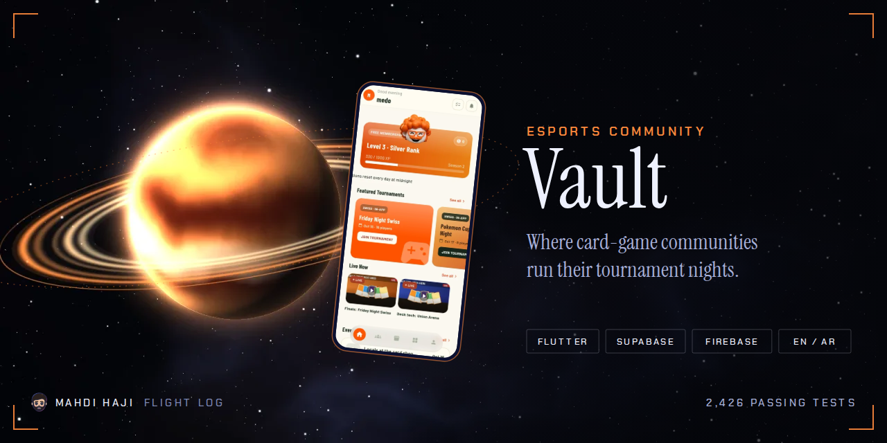
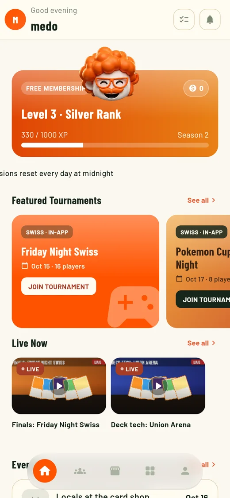
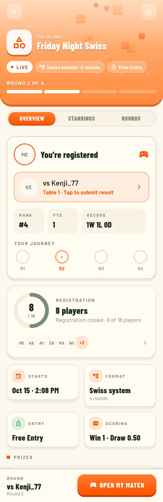
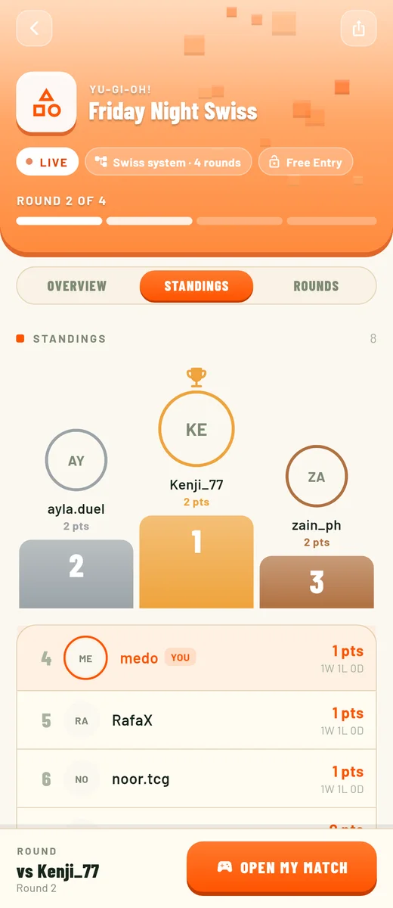
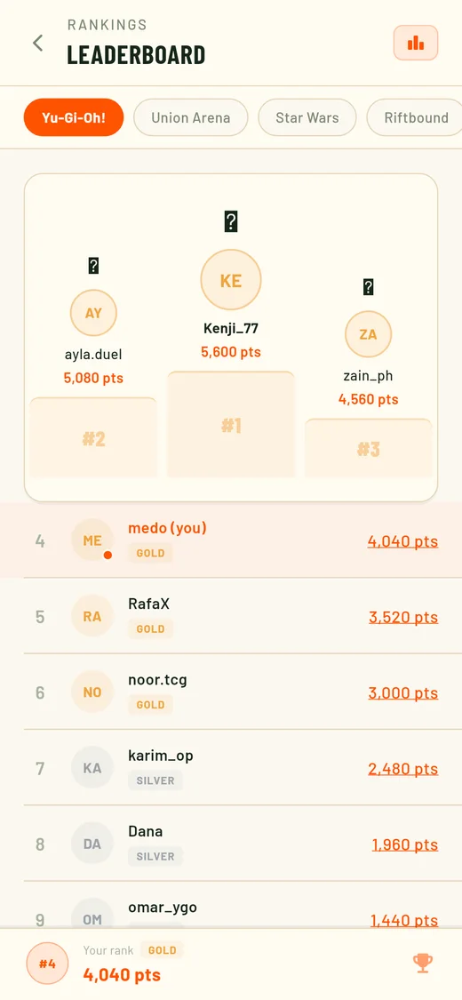
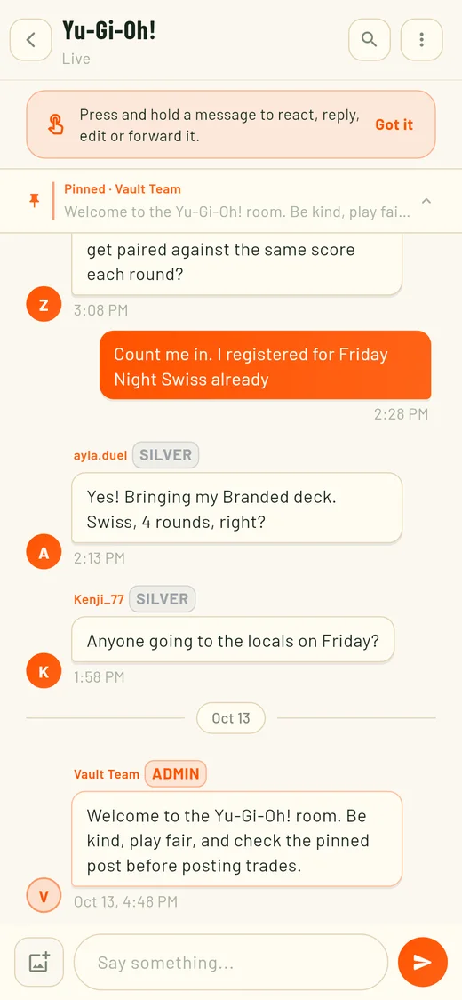
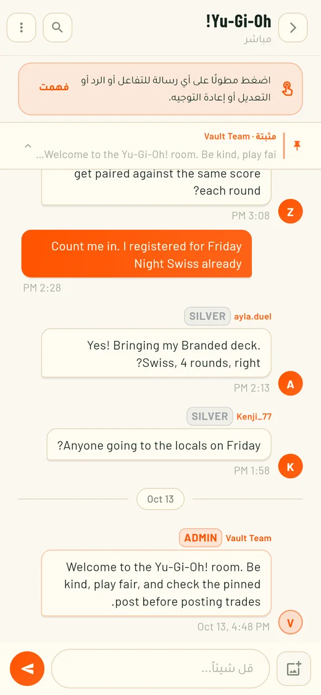
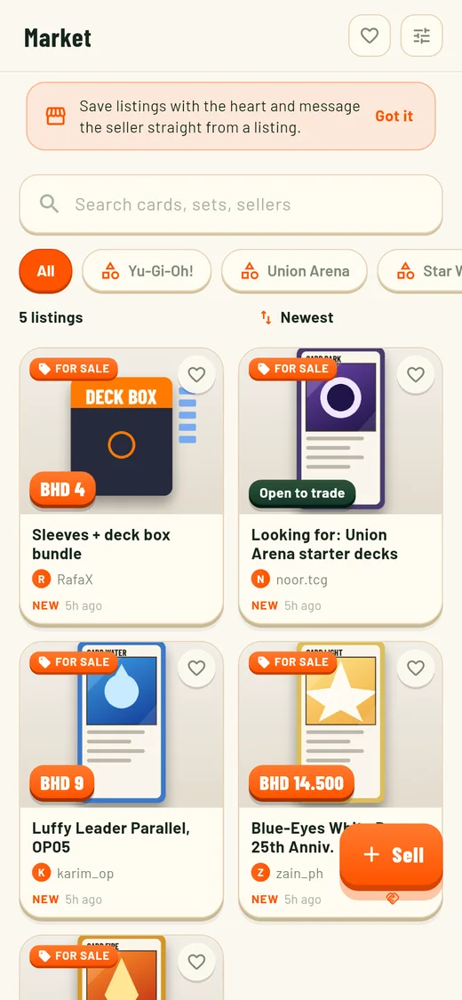
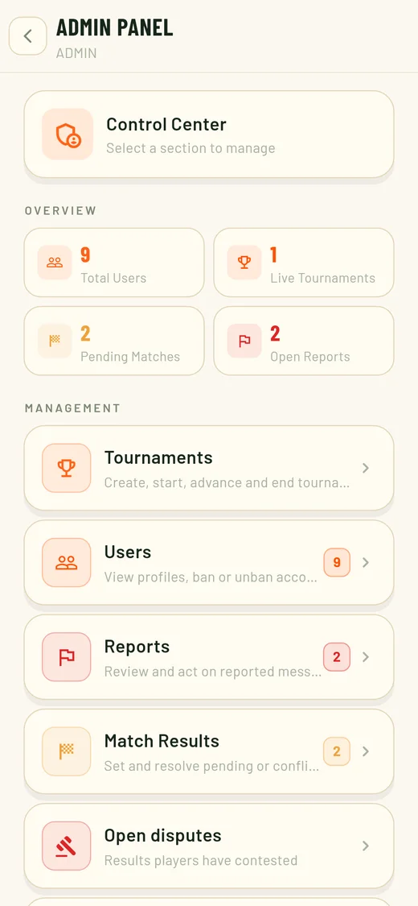
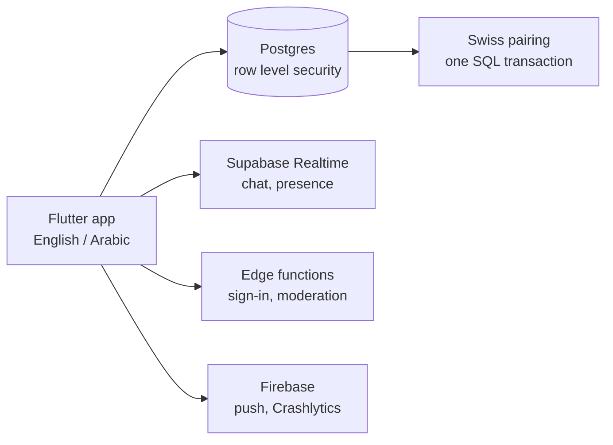

# Vault

Where card-game communities run their tournament nights. Join Swiss tournaments, follow a community for each game, chat in realtime, trade in a marketplace, and earn XP that follows you.

`Flutter` `Supabase` `Firebase` `English / Arabic` `Light and dark`

> [!NOTE]
> 🔒 **The source code is private.** This repo shows the product. A live demo or a code walkthrough is available on request: [email](mailto:mahdemghr2003@gmail.com) or [LinkedIn](https://www.linkedin.com/in/mahdi-mohamed-875120317).
> Website: **[vaulttcgg.com](https://vaulttcgg.com)** · Interactive case study (play a Swiss round): **[mahdi-haji.dev/vault.html](https://mahdi-haji.dev/vault.html)**

## Screens

<table>
<tr>
<td align="center" width="25%"> Home</td>
<td align="center" width="25%"> Tournament</td>
<td align="center" width="25%"> Swiss standings</td>
<td align="center" width="25%"> Per-game leaderboard</td>
</tr>
<tr>
<td align="center"> Community chat</td>
<td align="center"> Arabic, right to left</td>
<td align="center"> Marketplace</td>
<td align="center"> Admin control center</td>
</tr>
</table>

Real app screens, rendered with demo data.

## What it does

- **Swiss tournaments.** Nobody is knocked out: each round pairs players on the same score. Organisers set rounds, player cap, start time, points and an optional entry fee in BHD.
- **Results with a referee.** Players submit their own results. Disagreements turn into conflicts that an admin or the game's sub-admin settles, and seasons add their own leaderboards.
- **A home for every game:** a feed, a leaderboard, chat rooms and tournament nights for Yu-Gi-Oh!, Pokémon, One Piece and more. Admins add new games from inside the app.
- **XP, ranks and missions.** Bronze to Platinum per game, plus daily, weekly and monthly missions. Memberships (Silver, Gold, Elite) expire on their own.
- **Chat that polices itself, fairly.** Text and images are screened before they send. Violations climb a ladder (warn, mute, ban), and bans are enforced by the database, not just the app.
- **Trade and watch:** a marketplace whose listings expire, live stream players on Home, news, and a weekly calendar.
- **Run it from the phone:** about twenty admin screens, with four roles (user, sub-admin, admin, owner).

## How it's built

- About 124k lines of Dart in 384 files, with **2,426 passing automated tests**.
- No state-management package: screens hold their own state, and services are plain classes that call Supabase.
- English and Arabic from the start (about 2,800 lines of strings with a runtime switch), plus a responsive audit of around 270 cases.

## Decisions I'd defend

- **Pairing lives in one Postgres function.** The Dart version exists only for unit tests, so two admins can never create two different first rounds.
- **The app only hides buttons; the database decides.** Permission checks are database policies and functions, and only the owner can change roles, which a trigger enforces.
- **A hardened backend:** row level security on user data, rate-limited sign-in through a server function, and secrets kept out of the app.

## Status

A project by Mahdi Haji. Still open: sign-up end to end, push delivery and the release build were verified by tests and database checks, not yet on a physical phone. Typed models were swapped for plain maps, which keeps screens simple but moves checking to runtime.

## Contact

[mahdi-haji.dev](https://mahdi-haji.dev) · [LinkedIn](https://www.linkedin.com/in/mahdi-mohamed-875120317) · [Email](mailto:mahdemghr2003@gmail.com) · [All projects](https://github.com/mahdawemghr)

© 2026 Mahdi Haji. All rights reserved.
